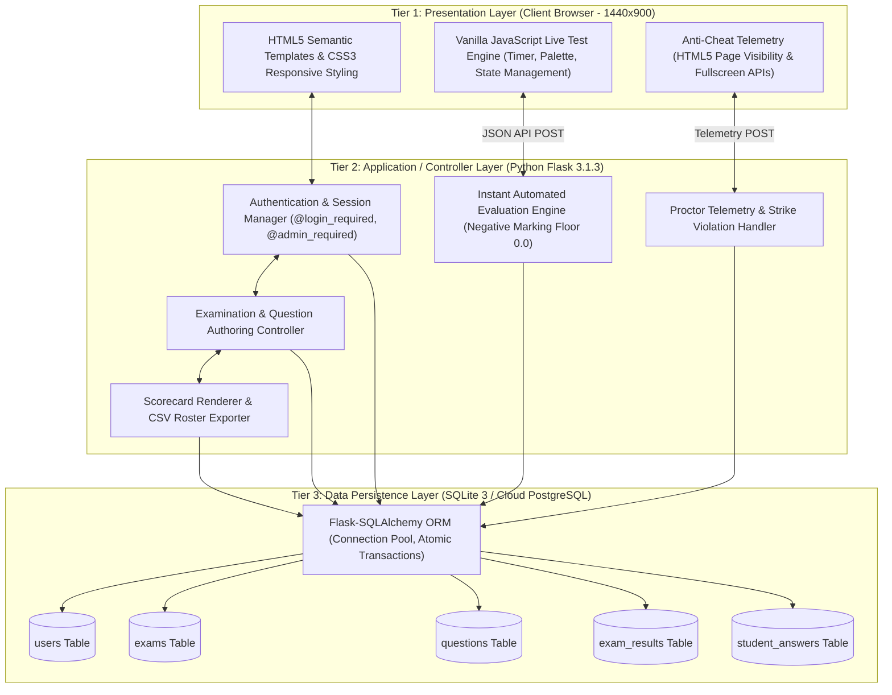
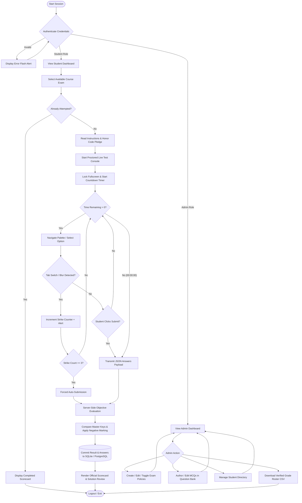
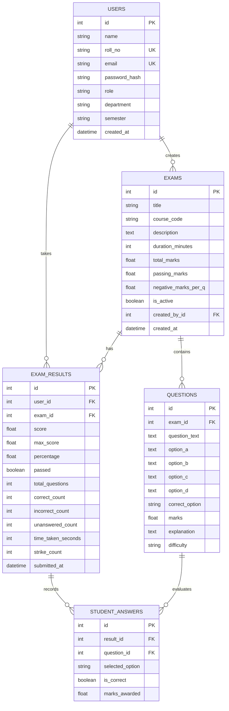

# Presidency University
### School of Computer Science & Engineering
## B.Tech CSE Mini-Project Report & Comprehensive Viva Guide (CSE2271)

# Project Title: Online Examination and Result Management System

---

## Academic & Project Metadata

- **Course Code & Title:** CSE2271 – Mini Project Review & Demo
- **Program:** Bachelor of Technology (B.Tech) in Computer Science & Engineering
- **Department:** Department of Computer Science & Engineering
- **Institution:** Presidency University, Bengaluru
- **Academic Year:** 2026–2027
- **Architecture Pattern:** 3-Tier Model-View-Controller (MVC)
- **Technology Stack:** HTML5, CSS3 Grid/Flexbox, Vanilla JavaScript (ES6+), Python Flask 3.1.3, SQLite 3 / PostgreSQL, Flask-SQLAlchemy ORM, Werkzeug Security

---

## Abstract

The **Online Examination and Result Management System** is an enterprise-grade, responsive, full-stack web application engineered to transform paper-intensive academic evaluations into a paperless, secure, automated, and tamper-resistant assessment ecosystem. Developed specifically for university engineering departments, the system facilitates role-based workflows for students and faculty administrators. Key capabilities include course-based examination scheduling, multi-format Multiple Choice Question (MCQ) authoring, synchronized countdown timers, an interactive 4-state question palette, automated real-time answer evaluation incorporating negative marking penalties, and instant multi-dimensional performance scorecards.

To ensure academic honesty during uninvigilated or distributed testing, the platform implements a client-side proctoring engine utilizing the **HTML5 Page Visibility API** and **Window Focus/Blur Events**, detecting unauthorized tab switches, window minimization, or external search engine lookups with a progressive 3-strike threshold that triggers automatic test lock and submission. The application strictly follows the Model-View-Controller (MVC) paradigm without external frontend heavyweight frameworks (no React, Angular, or Node.js), ensuring sub-second rendering latency on low-resource lab devices. The database architecture is fully normalized across five relational entities with cascading foreign-key integrity, supporting both local SQLite for development and PostgreSQL for scalable cloud serverless deployment on Vercel.

---

## 1. Introduction & Background

In higher education institutions, examinations serve as the primary metric for evaluating student cognitive comprehension, technical competency, and course learning outcomes. However, conventional manual assessment methods impose severe administrative bottlenecks, substantial paper waste, physical grading delays, and vulnerability to human collation errors.

With the advent of modern web standards and lightweight Python server frameworks, universities can conduct continuous objective assessments with zero paper usage, instantaneous candidate feedback, and automated audit logging. The **Online Examination and Result Management System** addresses these needs by combining a responsive university-branded interface with a robust Python Flask backend and relational database persistence.

---

## 2. Problem Statement & Motivation

Traditional university assessment processes face significant operational challenges:

1. **High Paper & Logistical Costs:** Printing, sorting, distributing, and physically archiving thousands of examination sheets each academic cycle.
2. **Evaluation Latency & Grading Overhead:** Manual correction of objective sheets requires substantial faculty hours, delaying result publication and academic intervention.
3. **Cheating & Integrity Vulnerabilities:** Unsupervised computer-based tests face risks of candidates opening external browser tabs or search engines during evaluations.
4. **Delayed & Shallow Feedback:** Students receive only cumulative marks weeks later, without granular question-by-question explanations, difficulty analysis, or timing metrics.
5. **Data Inconsistency & Security Risks:** Physical grade records are susceptible to misplacement, transcription errors, or unauthorized tampering.

### The Proposed Solution:
An integrated, end-to-end assessment platform that guarantees:
- Role-based isolation between student examinees and faculty administrators.
- Synchronized, server-authoritative countdown timers preventing local clock manipulation.
- Layered anti-cheat browser proctoring detecting tab switching and window blurring.
- Automated instant objective grading with configurable positive marks and negative penalties.
- Permanent relational storage with individual answer auditing and CSV export for department records.

---

## 3. Project Objectives & Scope

### Project Objectives:
1. **Develop a 3-Tier Web Application:** Implement a modular MVC architecture using semantic HTML5/CSS3/Vanilla JS (Presentation), Python Flask 3.1.3 (Application Logic), and SQLite/SQLAlchemy (Data Persistence).
2. **Deliver Role-Based Portals:** Provide secure authentication for Students (exam attendance, history, scorecards) and Administrators (exam creation, question banking, student management, results analytics).
3. **Incorporate Real-Time Proctoring:** Implement client-side telemetry using HTML5 Page Visibility APIs to detect cheating attempts with a progressive strike warning mechanism.
4. **Automate Objective Grading:** Execute server-side answer evaluation that accurately computes positive scores, applies negative marking deductions, enforces a $0.0$ score floor, and determines pass/fail status against defined cutoffs.
5. **Ensure Cross-Platform Accessibility:** Design a consistent, responsive 1440 × 900 desktop layout that adapts smoothly to mobile devices and tablets using CSS Grid and Flexbox.

### Scope:
- **In Scope:** Student registration, authenticated login, admin analytics dashboard, exam scheduling, MCQ authoring, live examination console, 4-state question palette, countdown timer, anti-cheat tab-switch detection, automated grading, scorecard review with explanations, student examination history, admin results directory, CSV roster export, and multi-database support (SQLite / PostgreSQL).
- **Out of Scope:** Subjective essay automated grading (NLP/AI evaluation), biometrics hardware facial recognition, and live video streaming feeds.

---

## 4. Requirements Specification

### A. Functional Requirements (10 Core Requirements)

| Requirement ID | Module Name | Functional Specification Description |
| :---: | :--- | :--- |
| **FR01** | User Authentication & RBAC | Provides distinct login interfaces for **Students** and **Faculty Administrators**. Enforces salted password hashing (`scrypt`/`pbkdf2`), cryptographically signed session cookies, and role-based route protection (`@login_required`, `@admin_required`). |
| **FR02** | Student Self-Registration | Prospective examinees can self-register by providing Full Name, University Roll Number (PRN), Email, Department, and Academic Semester, with validation against duplicate credentials. |
| **FR03** | Faculty / Admin Dashboard | Displays live academic metrics including Total Examinations, Active Question Bank count, Registered Students, Total Submissions, Batch Average Score, and recent assessment activity. |
| **FR04** | Examination Management | Faculty can create, edit, delete, and toggle status (*Live / Published* vs *Draft / Inactive*) for course examinations, configuring duration (minutes), total marks, passing cutoff, and negative marking penalties. |
| **FR05** | Question Bank Authoring | Faculty can author Multiple Choice Questions (MCQs) with 4 options (A, B, C, D), designated master answer key, mark weightage, difficulty classification (*Easy, Medium, Hard*), and educational rationale explanations. |
| **FR06** | Student Portal & Instructions | Students can view active examinations, check course requirements, review negative marking policies, accept the Academic Honor Code Pledge, and launch the live test console. |
| **FR07** | Live Test Console & Timer | Provides an authoritative countdown timer synchronized with the test duration, auto-submitting when the clock reaches `00:00:00`. Displays an interactive 4-state question palette (*Answered, Marked for Review, Visited Unanswered, Not Visited*). |
| **FR08** | Anti-Cheat Proctoring | Utilizes the HTML5 Page Visibility API and Window Blur listeners to detect window minimization or tab switching. Logs violation timestamps, displays warning modals, and forces automatic submission upon the 3rd strike. |
| **FR09** | Automated Server-Side Grading | Compares student choices with master keys immediately upon submission; computes positive marks, deducts negative penalties, applies a $0.0$ minimum floor, and determines pass/fail status without exposing keys to the client. |
| **FR10** | Scorecard & Result Reporting | Generates instant student scorecards with accuracy breakdown, time consumed, strike history, and question solutions. Provides administrators with a filtered result roster and streaming CSV export. |

---

### B. Non-Functional Requirements (6 Core Requirements)

1. **NFR01: High Performance & Sub-Second Latency:**
   - Client pages load in $< 1.5$ seconds over standard broadband.
   - Asynchronous JSON examination submission processes and completes database commits in $< 300\text{ ms}$.
   - Zero frontend framework compilation overhead (Pure HTML5, CSS3, and ES6+ Vanilla JavaScript).
2. **NFR02: Security & Tamper Resistance:**
   - Zero Answer Key Exposure: The `/exam/<id>/start` JSON endpoint explicitly strips `correct_option` and `explanation` from the payload delivered to the client.
   - All passwords stored as salted cryptographic hashes via Werkzeug Security (`generate_password_hash`, `check_password_hash`).
   - Single Attempt Guarantee: Once an examination is submitted, duplicate attempts are blocked with HTTP 400.
   - Privacy Isolation: Students can only view their own scorecards; attempting to access another candidate's result triggers an unauthorized access redirect.
3. **NFR03: Reliability & ACID Data Integrity:**
   - Atomic database transactions ensure that `ExamResult` and all `StudentAnswer` records are committed together in a single transaction block (`db.session.commit()`). If an exception occurs, the transaction rolls back completely.
4. **NFR04: Usability & University Brand Consistency:**
   - Visual styling adheres to official university palette guidelines: Academic Navy Blue (`#0f172a`), Primary Sky Blue (`#0284c7`), Accent Teal (`#0d9488`), White (`#ffffff`), and Neutral Light Grey (`#f8fafc`).
   - Standardized 1440 × 900 desktop viewport with responsive CSS Grid/Flexbox breakpoints for smaller screens.
5. **NFR05: Maintainability & 3-Tier Modularity:**
   - Strict separation of Presentation (`templates/`, `static/`), Business Logic (`app.py`), and Data Persistence (`models.py`, `config.py`).
6. **NFR06: Environment & Database Portability:**
   - Dynamic database connection detection: Automatically runs on local **SQLite** (`instance/exam_system.db`) for offline development and connects to cloud **PostgreSQL** in production via `DATABASE_URL` (compatible with Neon, Supabase, and Vercel Postgres).

---

## 5. System Architecture & UML Diagrams

### A. 3-Tier MVC Architecture Diagram



---

### B. UML Use Case Diagram

```mermaid
flowchart LR
    subgraph Actors
        Student["🎓 Student Candidate"]
        Admin["🛡️ Faculty / Administrator"]
    end

    subgraph System["Online Examination and Result Management System"]
        UC01(["UC01: Register & Authenticate"])
        UC02(["UC02: View Scheduled Examinations"])
        UC03(["UC03: Take MCQ Exam with Timer"])
        UC04(["UC04: Anti-Cheat Tab-Switch Detection"])
        UC05(["UC05: View Instant Scorecard & History"])
        UC06(["UC06: Author MCQ Questions in Bank"])
        UC07(["UC07: Create, Configure & Publish Exams"])
        UC08(["UC08: Manage Student Accounts"])
        UC09(["UC09: Automated Answer Key Grading"])
        UC10(["UC10: Export CSV Results Roster"])
    end

    Student --> UC01
    Student --> UC02
    Student --> UC03
    UC03 -.->|includes| UC04
    UC03 -.->|triggers| UC09
    UC09 -.->|generates| UC05
    Student --> UC05

    Admin --> UC01
    Admin --> UC06
    Admin --> UC07
    Admin --> UC08
    Admin --> UC10
    UC07 -.->|configures| UC09
```



---

### C. UML Activity Diagram (Examination & Grading Lifecycle)



---

### D. Entity-Relationship (ER) Diagram



---

## 6. Database Design & Relational Schema

The data persistence layer is designed in **Third Normal Form (3NF)** with explicit foreign-key constraints and cascading deletion rules:

```sql
-- 1. Users Table (Authentication, Profiles & Roles)
CREATE TABLE users (
    id INTEGER PRIMARY KEY AUTOINCREMENT,
    name VARCHAR(100) NOT NULL,
    roll_no VARCHAR(50) UNIQUE,
    email VARCHAR(120) UNIQUE NOT NULL,
    password_hash VARCHAR(256) NOT NULL,
    role VARCHAR(20) NOT NULL DEFAULT 'student',  -- 'student' or 'admin'
    department VARCHAR(100) DEFAULT 'Computer Science and Engineering',
    semester VARCHAR(20) DEFAULT '4th Semester',
    created_at DATETIME DEFAULT CURRENT_TIMESTAMP
);

-- 2. Exams Table (Course Assessments & Parameters)
CREATE TABLE exams (
    id INTEGER PRIMARY KEY AUTOINCREMENT,
    title VARCHAR(200) NOT NULL,
    course_code VARCHAR(50) NOT NULL,
    description TEXT,
    duration_minutes INTEGER NOT NULL DEFAULT 60,
    total_marks FLOAT NOT NULL DEFAULT 50.0,
    passing_marks FLOAT NOT NULL DEFAULT 20.0,
    negative_marks_per_q FLOAT NOT NULL DEFAULT 0.25,
    is_active BOOLEAN DEFAULT 1,
    created_by_id INTEGER REFERENCES users(id),
    created_at DATETIME DEFAULT CURRENT_TIMESTAMP
);

-- 3. Questions Table (MCQ Bank & Master Keys)
CREATE TABLE questions (
    id INTEGER PRIMARY KEY AUTOINCREMENT,
    exam_id INTEGER NOT NULL REFERENCES exams(id) ON DELETE CASCADE,
    question_text TEXT NOT NULL,
    option_a TEXT NOT NULL,
    option_b TEXT NOT NULL,
    option_c TEXT NOT NULL,
    option_d TEXT NOT NULL,
    correct_option VARCHAR(1) NOT NULL,            -- 'A', 'B', 'C', 'D'
    marks FLOAT NOT NULL DEFAULT 2.0,
    explanation TEXT,
    difficulty VARCHAR(20) DEFAULT 'Medium'        -- 'Easy', 'Medium', 'Hard'
);

-- 4. Exam Results Table (Scorecards & Telemetry)
CREATE TABLE exam_results (
    id INTEGER PRIMARY KEY AUTOINCREMENT,
    user_id INTEGER NOT NULL REFERENCES users(id) ON DELETE CASCADE,
    exam_id INTEGER NOT NULL REFERENCES exams(id) ON DELETE CASCADE,
    score FLOAT NOT NULL,
    max_score FLOAT NOT NULL,
    percentage FLOAT NOT NULL,
    passed BOOLEAN NOT NULL,
    total_questions INTEGER NOT NULL,
    correct_count INTEGER NOT NULL,
    incorrect_count INTEGER NOT NULL,
    unanswered_count INTEGER NOT NULL,
    time_taken_seconds INTEGER DEFAULT 0,
    strike_count INTEGER DEFAULT 0,
    submitted_at DATETIME DEFAULT CURRENT_TIMESTAMP
);

-- 5. Student Answers Table (Granular Responses & Audit Trail)
CREATE TABLE student_answers (
    id INTEGER PRIMARY KEY AUTOINCREMENT,
    result_id INTEGER NOT NULL REFERENCES exam_results(id) ON DELETE CASCADE,
    question_id INTEGER NOT NULL REFERENCES questions(id) ON DELETE CASCADE,
    selected_option VARCHAR(1),                    -- 'A', 'B', 'C', 'D' or NULL
    is_correct BOOLEAN DEFAULT 0,
    marks_awarded FLOAT DEFAULT 0.0
);
```

---

## 7. System Implementation Details

### A. Authentication & Session Management
- **Password Security:** Hashes passwords using Werkzeug's secure implementation (`generate_password_hash`, `check_password_hash`) with automatic cryptographic salt. Plaintext passwords are never stored.
- **Route Authorization:** Custom Python decorators `@login_required` and `@admin_required` inspect session state and deny unauthorized access:
  ```python
  def admin_required(f):
      @wraps(f)
      def decorated_function(*args, **kwargs):
          if 'user_id' not in session or session.get('user_role') != 'admin':
              flash('Access denied. Administrator privileges required.', 'danger')
              return redirect(url_for('login', role='admin'))
          return f(*args, **kwargs)
      return decorated_function
  ```

### B. Anti-Cheating & Real-Time Proctoring
- **Fullscreen API:** Requests browser fullscreen mode upon test launch.
- **Page Visibility & Focus Telemetry:** JavaScript listens for `document.visibilitychange` and `window.blur`:
  ```javascript
  document.addEventListener("visibilitychange", () => {
    if (document.hidden && !isSubmitted) {
      logProctorViolation("Tab switch or window blur detected");
    }
  });
  ```
- **3-Strike Progressive Enforcement:**
  - Strike 1 & 2: Warning modal with timestamp and red strike pips.
  - Strike 3: Critical alert, exam is immediately locked, timer halted, and answers auto-submitted.

### C. Live Test Engine & 4-State Question Palette
- **Client State Management:** Client JavaScript maintains `userAnswers`, `reviewFlags`, and `visitedStatus` in active memory.
- **Color-Coded Status Palette:**
  - **Green (`.answered`):** Option selected and saved.
  - **Orange (`.review`):** Marked for review.
  - **Red (`.unanswered`):** Visited but no option chosen.
  - **Grey (Default):** Not visited yet.
- **Authoritative Countdown Timer:** Computes remaining seconds and updates the visual badge `00:MM:SS`. Turns warning red when under 5 minutes; auto-submits upon expiry.

### D. Automated Server-Side Evaluation Engine
When the candidate finishes, `/api/exam/<id>/submit` processes the answers payload:
```python
total_score = 0.0
for q in questions:
    chosen = submitted_answers.get(str(q.id))
    if chosen:
        if chosen.upper() == q.correct_option.upper():
            awarded = q.marks
            correct_count += 1
        else:
            awarded = -exam.negative_marks_per_q
            incorrect_count += 1
    else:
        awarded = 0.0
        unanswered_count += 1
    total_score += awarded

final_score = max(0.0, round(total_score, 2))
percentage = round((final_score / max_score) * 100, 2)
passed = final_score >= exam.passing_marks
```

---

## 8. Five Core UI Modules & Screen Walkthrough

| Module # | Screen Title | Rendered File Reference | Primary User Workflow & Features |
| :---: | :--- | :--- | :--- |
| **Module 1** | Login & Registration | `screen1_login_reg.png` / `.svg` | Role-aware login toggle (Student vs Admin/Faculty), Student registration form with Roll No and Semester validation, salted password authentication. |
| **Module 2** | Student Dashboard | `screen2_student_dashboard.png` / `.svg` | Student profile overview, quick KPI cards (Available Exams, Completed, Average Score), Available Examinations list with "Instructions & Start" buttons, and past result records. |
| **Module 3** | Admin Dashboard & Desk | `screen3_admin_dashboard.png` / `.svg` | Real-time university analytics desk: Total Exams, Question Bank count, Registered Students, Batch Average; quick links to Create Exam, Question Bank, and Export CSV. |
| **Module 4** | Live Examination Console | `screen4_online_exam.png` / `.svg` | Proctored test environment with 4-state Question Palette, Authoritative Countdown Timer, Previous/Next navigation, Clear Selection, Mark for Review, and Tab-Switch Detection modal. |
| **Module 5** | Result Management & Scorecard | `screen5_result_management.png` / `.svg` | Instant verified scorecard: Score, Percentage, Status badge (PASSED/FAILED), Time Taken, Anti-Cheat Strikes, plus Question-by-Question Solution Review with academic explanations. |

---

## 9. Verification & Testing Methodology

The system includes a comprehensive automated test suite (`test_application.py`) executing 12 unit, integration, and security test cases against an isolated in-memory SQLite database:

| Test Case # | Method Name | Scope & Verification Target | Result |
| :---: | :--- | :--- | :---: |
| **TC01** | `test_user_password_hashing` | Cryptographic salting via Werkzeug `check_password` | **PASSED** |
| **TC02** | `test_student_registration_success` | Full registration flow and database persistence | **PASSED** |
| **TC03** | `test_registration_validation_duplicate_email` | Rejection of duplicate email addresses | **PASSED** |
| **TC04** | `test_registration_validation_password_mismatch` | Password confirmation mismatch detection | **PASSED** |
| **TC05** | `test_student_login_and_logout` | Authentication, session creation, and secure logout | **PASSED** |
| **TC06** | `test_admin_desk_security_barrier` | Access barrier blocking students from admin routes | **PASSED** |
| **TC07** | `test_admin_exam_crud` | Examination Create, Edit, Toggle Status, and Delete | **PASSED** |
| **TC08** | `test_admin_question_authoring_and_editing` | Question Bank Create, Edit, and Delete operations | **PASSED** |
| **TC09** | `test_admin_student_directory_and_management` | Student listing and record removal | **PASSED** |
| **TC10** | `test_exam_start_payload_security` | Zero client leakage of master keys & explanations | **PASSED** |
| **TC11** | `test_exam_submission_and_automatic_evaluation` | Auto-grading, negative marking, single-attempt lock & privacy isolation | **PASSED** |
| **TC12** | `test_admin_csv_export` | Streaming CSV generation with candidate grade roster | **PASSED** |

### Execution Command & Result:
```bash
python test_application.py
----------------------------------------------------------------------
Ran 12 tests in 16.033s

OK
```

---

## 10. Deployment & Hosting (Local & Production Vercel)

### A. Local Development Execution (SQLite):
1. Install dependencies:
   ```bash
   pip install -r requirements.txt
   ```
2. Initialize database and seed demo catalog:
   ```bash
   python seed_data.py
   ```
3. Start the Flask application server:
   ```bash
   python run.py
   ```
4. Access via browser: **`http://127.0.0.1:5000`**

### B. Cloud Serverless Deployment (Vercel & PostgreSQL):
- Configured via root [vercel.json](file:///c:/Users/Eknath/OneDrive/Desktop/OnlineExaminationSystem/vercel.json) and WSGI entrypoint [api/index.py](file:///c:/Users/Eknath/OneDrive/Desktop/OnlineExaminationSystem/api/index.py).
- Supported by cloud PostgreSQL via `DATABASE_URL` (Neon / Supabase / Vercel Postgres).
- Production runtime: Python 3.12 pinned via [.python-version](file:///c:/Users/Eknath/OneDrive/Desktop/OnlineExaminationSystem/.python-version).
- One-time cloud seeding via CLI:
  ```powershell
  $env:DATABASE_URL="your-postgresql-connection-uri"
  python seed_data.py
  ```

---

## 11. Conclusion & Future Enhancements

### Conclusion:
The **Online Examination and Result Management System** successfully delivers an end-to-end, paperless assessment portal fulfilling all requirements of the **CSE2271 Mini-Project Review & Demo**. By strictly adhering to 3-tier MVC principles, avoiding client-side heavyweight dependencies, enforcing server-authoritative grading, and embedding client anti-cheat telemetry, the system provides university departments with a reliable, scalable, and instant evaluation platform.

### Future Enhancements:
1. **AI-Assisted Subjective Question Grading:** Integration of Large Language Models (LLMs) via the Gemini API to evaluate descriptive and short-answer questions against standard rubric benchmarks.
2. **WebRTC AI Proctoring:** Continuous webcam stream monitoring with computer-vision head-pose estimation and multi-face detection.
3. **Automated Question Bank Import:** Bulk MCQ ingestion via `.csv`, `.xlsx`, or LaTeX `.tex` uploads.
4. **Offline Progressive Web App (PWA):** Service worker caching allowing candidates to complete examinations during full campus network outages with background sync upon reconnection.

---

## 12. Viva Voce Defense Guide (CSE2271 Examination Q&A)

### Q1: What architectural pattern does this application implement?
> **Answer:** The application strictly implements the **3-Tier Model-View-Controller (MVC)** architectural pattern:
> - **Model (`models.py`):** Defines the database schema across 5 normalized relational tables (`User`, `Exam`, `Question`, `ExamResult`, `StudentAnswer`) using Flask-SQLAlchemy ORM.
> - **View (`templates/`, `static/`):** Semantic HTML5 templates styled with responsive CSS3 and driven by Vanilla JavaScript for live timer and palette rendering.
> - **Controller (`app.py`):** Routes incoming HTTP requests, enforces session authentication via decorators (`@login_required`, `@admin_required`), executes business logic, and manages database transactions.

### Q2: How does the system prevent student cheating during an online exam?
> **Answer:** The system uses a multi-layered proctoring approach:
> 1. **Fullscreen Lockdown:** The browser triggers fullscreen mode upon starting the assessment.
> 2. **Page Visibility & Window Blur API:** JavaScript listens for `document.visibilitychange` and `window.blur` events. If the examinee opens a new tab, switches windows, or accesses another program, a strike is logged and a warning modal appears. On the **3rd strike**, the exam locks and auto-submits.
> 3. **Zero Answer Key Leakage:** The `/exam/<id>/start` JSON endpoint strips out `correct_option` and `explanation` attributes before serialization. Answer evaluation is conducted strictly server-side.

### Q3: How is automatic grading calculated, and how is negative marking handled?
> **Answer:** When an examination is submitted, the server compares the student's selected choices against the master answer keys in SQLite/PostgreSQL:
> - **Correct Answer:** Awards the full positive question marks (`+question.marks`, e.g., $+2.0$).
> - **Incorrect Answer:** Deducts the configured negative penalty (`-exam.negative_marks_per_q`, e.g., $-0.25$).
> - **Unanswered:** Incurs zero deduction ($0.0$).
> The total score is floored at $0.0$ to prevent negative cumulative marks, percentage is computed against maximum score, and pass/fail is determined by comparing against `exam.passing_marks`.

### Q4: Why did you use Vanilla JavaScript instead of React or Vue?
> **Answer:** For university examination portals, Vanilla JavaScript provides three key advantages:
> 1. **Zero Client Build Overhead:** Requires no Node.js build steps, npm bundles, or webpack compiling, enabling instant deployment.
> 2. **Low-Resource Compatibility:** Runs with near-instant DOM rendering on low-specification university lab computers without memory bloat.
> 3. **Direct Event Handling:** Provides direct, uninhibited control over low-level browser APIs (`document.fullscreenElement`, `document.visibilitychange`, `window.blur`) without framework lifecycle delays.

### Q5: How is database concurrency and transaction safety guaranteed?
> **Answer:** Flask-SQLAlchemy executes the evaluation and answer insertion inside a single atomic database transaction (`db.session.commit()`). The candidate's `ExamResult` record and all individual `StudentAnswer` rows are committed together. If any runtime error or constraint violation occurs, `db.session.rollback()` reverts all partial operations, preventing orphaned records or corrupted scorecards.

---
*Created for Presidency University, Bengaluru — School of Computer Science & Engineering.*  
*Course: CSE2271 – Mini Project Review & Demo (2026–2027).*
